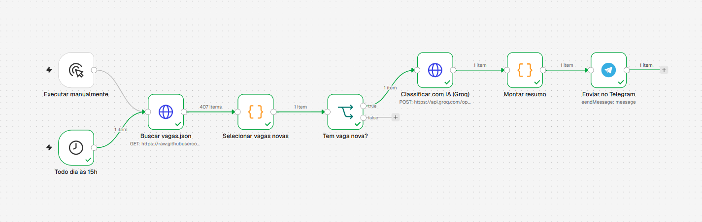
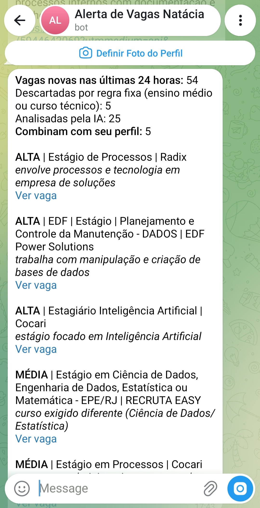

# Alerta diário de vagas de estágio com n8n e IA

Automação que, todo dia, pega as vagas de estágio novas coletadas pela minha [plataforma de busca de vagas](https://github.com/nataciaduarte/buscador-vagas), usa IA para classificar cada uma pela aderência ao meu perfil e me envia no Telegram só as que valem a pena abrir.

## O problema

A plataforma coleta dezenas de vagas de estágio por dia no Rio de Janeiro, de todas as áreas: direito, engenharia, saúde, administração, tecnologia. Ler todas para achar as poucas ligadas a IA, dados e automação toma tempo. Este fluxo faz essa triagem e entrega um resumo curto com os links.

## Como funciona

| Etapa | Nó no n8n | O que faz |
|---|---|---|
| 1 | Todo dia às 15h | Dispara o fluxo (também pode ser executado manualmente) |
| 2 | Buscar vagas.json | Baixa o arquivo de vagas publicado pela plataforma no GitHub |
| 3 | Selecionar vagas novas | Separa as vagas coletadas nas últimas 24 horas e descarta, por regra fixa, as que pedem ensino médio ou curso técnico |
| 4 | Tem vaga nova? | Interrompe o fluxo se não houver vaga nova |
| 5 | Classificar com IA (Groq) | Envia até 25 vagas para o modelo `openai/gpt-oss-120b`, que classifica cada uma como alta, média ou baixa aderência, com o motivo |
| 6 | Montar resumo | Junta a classificação com os dados das vagas e monta a mensagem |
| 7 | Enviar no Telegram | Envia o resumo para o meu chat, só com as vagas de aderência alta e média |

Para este fluxo existir, a plataforma de vagas passou a gerar também um arquivo `vagas.json` em cada coleta diária, porque o n8n não lê o banco SQLite direto do GitHub.

## Resultado

Mensagem recebida no Telegram na execução de 28/10/2026:

Nesse dia, das 54 vagas novas, 5 foram descartadas pela regra fixa, 25 foram analisadas pela IA e 5 foram destacadas.

## Validação: o que a IA errou e como corrigi

Conferi as classificações vaga por vaga nas primeiras execuções.

| Erro encontrado | Exemplo | Correção |
|---|---|---|
| A IA ignorava o curso exigido pela vaga | Estágio que exige Administração ou Engenharia de Produção classificado como média | Regra no prompt: curso exigido diferente do meu vira baixa; curso próximo (Computação, Estatística) fica no máximo em média |
| Vaga que não era estágio aparecia como opção | Auxiliar administrativo de recepção hospitalar classificado como média | Regra no prompt: se não for estágio nem vaga de tecnologia, é baixa |
| A IA inventava motivo quando a descrição estava vazia | Estágio em curso técnico com descrição genérica classificado como média por "uso de ferramentas digitais" | A regra no prompt não resolveu. Passei esse caso para uma regra fixa no código, que descarta vagas de ensino médio ou curso técnico antes de chamar a IA |

A lição principal foi separar o que é objetivo, resolvido com regra fixa no código, do que exige interpretação, deixado para a IA.

Problemas técnicos resolvidos durante a construção:

- O GitHub entrega o `vagas.json` como texto, e o n8n não separava as vagas. Corrigido configurando o formato da resposta como JSON.
- O modelo escolhido no início deixou de estar disponível no plano gratuito do Groq. Troquei para o `openai/gpt-oss-120b` e reduzi o lote para 25 vagas, para caber no limite por minuto.
- O envio ao Telegram dava tempo esgotado porque o Node.js tentava conectar por IPv6. Resolvido iniciando o n8n com a opção `--dns-result-order=ipv4first` (arquivo `iniciar-n8n.bat`).
- O Telegram removia os sublinhados dos links ao interpretar a mensagem como Markdown. Passei a montar a mensagem em HTML.

## Limitações conhecidas

- Em casos de fronteira, a classificação pode variar entre execuções, mesmo com temperatura zero. Uma mesma vaga de processos já apareceu como média em uma execução e alta em outra.
- A IA recebe só os primeiros 200 caracteres da descrição. Quando a descrição começa falando da empresa, as atividades da vaga ficam de fora.
- São analisadas no máximo 25 vagas por dia.
- O n8n roda no meu computador, então o disparo das 15h só acontece com o computador ligado e o n8n aberto.

## Como reproduzir

1. Instale o Node.js 24 (o n8n exige versão entre 20.19 e 24.x) e inicie o n8n com `iniciar-n8n.bat` ou com `npx n8n`.
2. Importe `alerta-vagas.json` no n8n.
3. No nó **Classificar com IA (Groq)**, crie uma credencial **Header Auth** com nome `Authorization` e valor `Bearer` seguido da sua chave do Groq.
4. No nó **Enviar no Telegram**, crie a credencial com o token do seu bot e troque `SEU_CHAT_ID` pelo ID do seu chat.
5. Ajuste o perfil da candidata, escrito no início do código do nó **Selecionar vagas novas**.

O código dos dois nós de código também está na pasta `codigo/`, para leitura.

## Tecnologias

n8n, JavaScript, API do Groq (modelo `openai/gpt-oss-120b`), API do Telegram, GitHub Actions e GitHub (fonte dos dados).

## Minha participação

O desenho do fluxo e o código foram produzidos com o Claude. Eu instalei e configurei o n8n no meu computador, criei as contas e as credenciais do Groq e do Telegram, importei e ajustei o fluxo, executei os testes e revisei os resultados junto com o Claude, que apontou os erros de classificação e propôs as correções.

---

**Natácia Duarte** · [LinkedIn](https://www.linkedin.com/in/nataciaduarte7a4860381) · [GitHub](https://github.com/nataciaduarte)
